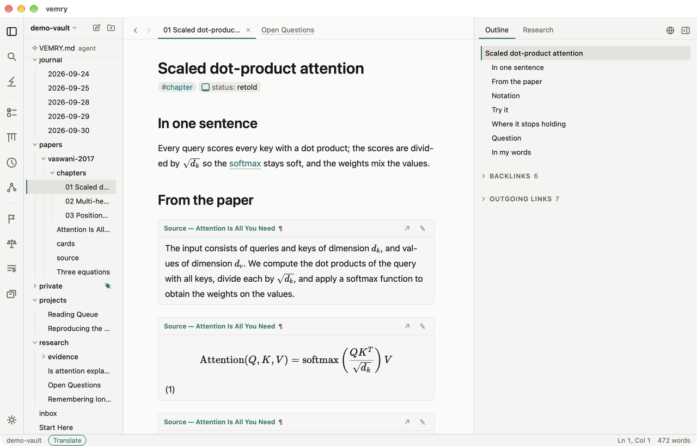
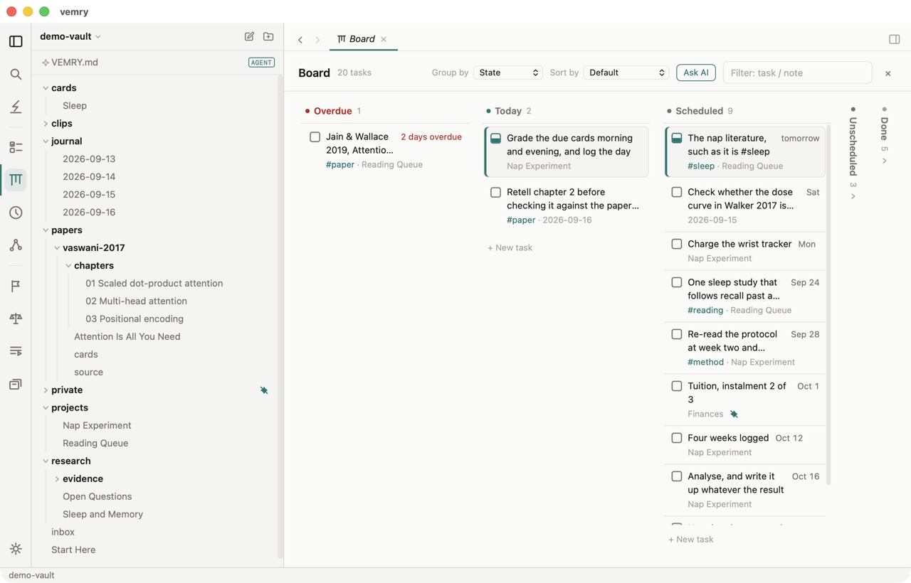
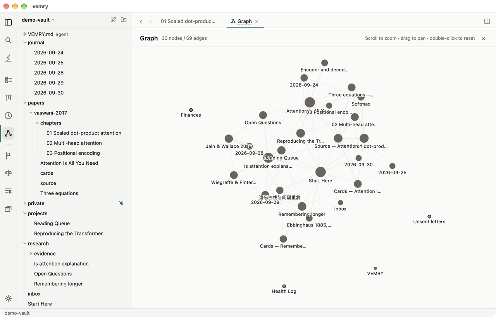
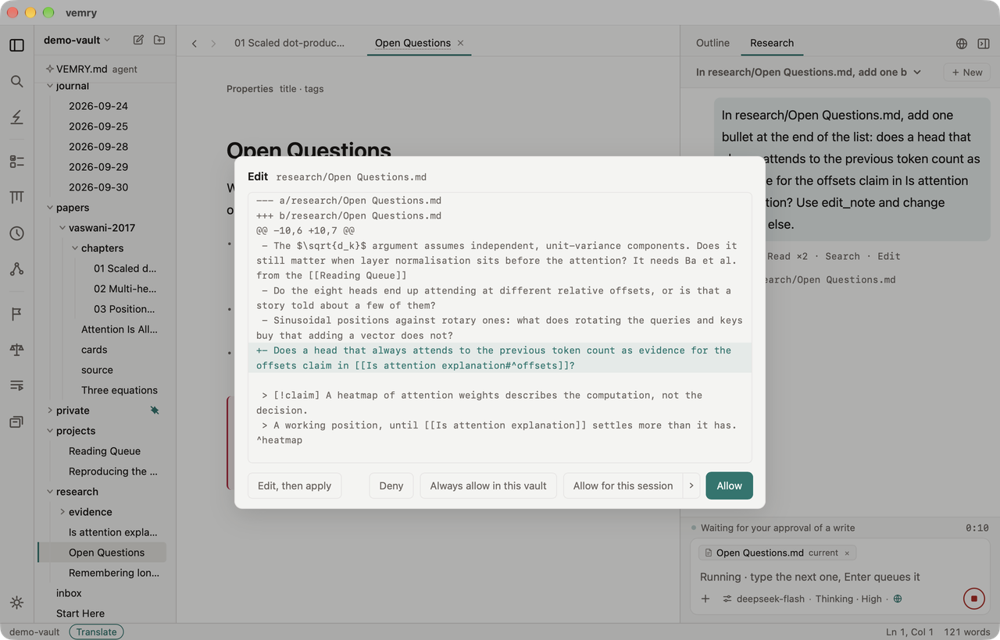

<div align="center">

# vemry

**Turn what you read into what you know.**

A local-first AI study workbench. Capture a thought, clip a page or a paper, read it
beside a translation, study it chapter by chapter and review it as cards. The AI does
the chores; the reading and thinking stay yours, in plain Markdown on your computer.

[**Download**](https://vemry.app/download) · [Website](https://vemry.app) · [Get started](#get-started) · [Docs](#learn-more) · [Discussions](https://github.com/pangyexing/vemry/discussions)

[](https://github.com/pangyexing/vemry/releases)
[](https://github.com/pangyexing/vemry/actions/workflows/ci.yml)
[](#license)


[English](README.md) · [简体中文](README.zh-CN.md)

</div>



<br>

**Your notes are files.** Plain Markdown in a folder you chose, with no database and
no format of its own. Open the folder in any editor and you see exactly what vemry
sees; if you ever switch tools, you take the folder with you.

**The AI asks before it writes.** Every edit stops at a diff you allow, deny, or
edit and then apply. What you mark private, the model never sees, and it cannot
tell that anything is missing.

**It works offline.** No sign-up, no telemetry, and nothing reaches the network
unless you did something that needs it. Without an API key it is still a complete
local editor; connect a model that runs on your own computer and even the AI stays
on your machine.

## What vemry is

vemry is an editor for a folder of Markdown, with an AI that works inside that
folder under your rules. Everything you see — the editor, every view, the AI's tools,
your own scripts — reads the same block-level index built from your files. There is
no second copy of your knowledge anywhere.

It is not a cloud service, and it is not a chat window with a notes folder
attached. The AI is one participant in your vault, with a permission gate in front
of every write and a privacy boundary it cannot see across.

Finish a paper and explain it in your own words. Where you drift, you see it on the
spot. When it starts to fade, a card brings it back. The tedious part — clipping to
Markdown, translating side by side, filing, tracing sources, making the cards — you
never do by hand, and every write still waits at a diff for your yes.

## What you can do

### Write without leaving the line

Type `/` at the start of a line and headings, tasks, tables, code and callouts are in
one menu that narrows as you type. ⌘P opens the command palette, where each of the
app's eighty-odd commands, and every command your scripts add, can be found by name,
typed in the interface's language or in English. Rich text copied from the web pastes
in as clean Markdown; however you write it, what is saved is always standard
Markdown.

| Key | Does |
|---|---|
| `/` | Insert any kind of block |
| `[[` | Link a note, or one of its sections or blocks |
| `@` | Dates, due dates, priorities and references |
| ⌘P | Command palette |
| ⌘O | Open a note by title |
| ⌘⇧F | Search every note |

### Catch the thought before it's gone

Whatever app you are in, press ⌥⇧Space and the capture box drops in. Type a line,
press Enter, and it is in your inbox without pulling you out of what you were doing.
When captures pile up, *File the inbox* sorts each one into the note where it
belongs.

Pair your phone by scanning a code, and what occurs to you on the go lands in the
same inbox: within a second if your computer is on, or the next time you open it if
not. Phone capture needs a vemry account (free); your captures travel through it to
your computer.

### Read in two languages at once

Open a page in the built-in browser and press *Translate*: each paragraph's
translation appears beside it as you read. For a PDF, press ⌘⇧T: the page on the
left, its translation on the right, each paragraph level with its original. Click a
translation and the passage it came from lights up, so checking it takes one glance.

Formulas stay as they are, and captions and references are never sent for
translation. Notes can be read side by side too, interleaved or as translation only,
and a translation can be saved as a note of its own. Translate into English,
Chinese, Japanese, Korean, French, German, Spanish and more.

### Clip anything worth keeping

Press ⌘⇧S in the built-in browser and the page becomes a note in `clips/`, with its
text, its images, its link and the date. The images are saved into your own folder,
so the note outlives the page. Want only one passage? Select it and press
*Selection → note*, and it lands in the note you are writing, with its source.

Papers are easier still: paste an arXiv link and every section, equation, figure and
table becomes a block you can cite on its own. On macOS, the built-in browser also
blocks ads and trackers.

### Understand it chapter by chapter

To read a paper, pick *Study a paper* and paste the link, or drop in a PDF. The source
comes in as blocks and is split into chapters; each chapter starts from what your
vault already knows, then moves on to what is new, with the passages it draws on
embedded alongside.

Finish a chapter and retell it in your own words: you see what you got right, what
you left out and which symbol you mixed up, each point linked to the paper. Want to
try the idea? Ask for an experiment and a runnable block appears in the chapter; it
runs only when you press Run. Everyday reading works the same way: open an article
in the Reader, ask as you go, and every answer names its source.

### See it again before it fades

Cards come only from the gaps in your retelling. The Review view brings them back as
they start to fade: press *Good* if you remembered and the next review comes later,
or *Again* if you didn't. The cards and their schedule live in your notes, as plain
Markdown.

### One vault, seen by the question you are asking

What is due today: Agenda. Where each thing stands: Board. What happened this
month: Timeline. How your notes connect: Graph. Which claims have evidence behind
them and which do not: Claims and Evidence. Which cards are due: Review. None of
them stores anything of its own; each is a query over the one index, so ticking off a
task in any of them changes that line in the file, and a `vemry-query` fence inside
a note renders the same query in place.





### Ask, and check the answer

Every answer cites the block it read, and the citation opens it. With web search on,
each source is marked verified or not, and an answer you want to keep goes into a
note as a block. Press `@` to hand the AI a note, a folder or the current selection.

### Hand over the chores, on your terms

Sixteen built-in skills cover the work around reading: tidy a folder, file the
inbox, restructure a note, turn meeting notes into actions, start and close the day,
draft the weekly report from the week's notes for you to finish. The chores go to
the AI; the reading, the retelling and the decisions stay with you. Add your own as
a Markdown file in `.vemry/skills/`. Every write is a diff, a whole turn's writes can
be undone, and every session is an audit log you can replay in the Session Replay
view.



### Automate with a script, not a plugin

Drop a `.js` file into `.vemry/scripts/` and it is live on save. Scripts register
palette commands, subscribe to vault events and run on a cron, inside a sandbox
with no filesystem, no network and no processes.

## Get started

1. **Install.** Download vemry for your platform from
   [vemry.app/download](https://vemry.app/download): a `.dmg` for Apple silicon or
   Intel, an `.exe` installer for Windows, an `.AppImage` or a `.deb` for Linux.
   Every file, with its checksum, is also on
   [Releases](https://github.com/pangyexing/vemry/releases); or
   [build from source](#build-from-source).
   - macOS 10.15 or later. Signed and notarised by Apple: it opens like any other app.
   - Windows 10 or later; the installer adds the WebView2 runtime if it is missing.
     The installer isn't signed yet: if SmartScreen stops it, choose *More info*,
     then *Run anyway*.
   - Linux with WebKitGTK 4.1, such as Ubuntu 22.04 or later. Make the AppImage
     executable before its first run: `chmod +x vemry_*.AppImage`.
2. **Open the example vault.** Clone this repo, then ⌘P → *Open another vault…* →
   `examples/demo-vault`. It is one learner's week in September 2026, the same story
   the website tells: a paper read in chapters, with two experiments you can run and
   the cards a checked retelling left; a project with its tasks; a research thread
   with its claims and evidence; a page clipped from the web and a handout to read
   in translation; an inbox of captures from a desktop and a phone; a journal, three
   recorded AI sessions and a private folder. Its *Start Here* note is the tour.
3. **Choose how the AI runs** (optional). Settings → AI. To bring your own key, add
   providers under *Your providers*: any OpenAI-compatible endpoint, its key, and the
   model ids it serves. Zhipu is there from the start, and its `glm-4.7-flash` is free
   and supports tool calls; the *Ollama, local* preset points at a model on your own
   machine. For *vemry hosted*, sign in with your e-mail address and its models join
   the list, with no key to set up: a new account's first sign-in from the desktop app
   comes with 600 credits to try, valid for 14 days, no card needed, and after that
   hosted AI comes with [Pro](#free-and-pro). Pick the current model there or from the
   chat's model menu. Either way, a request reaches the model vendor unchanged.
4. **Study a paper.** Open the AI panel, pick *Study a paper* and paste an arXiv
   link, or drop in a PDF. The source note, the chapters and the cards arrive as
   diffs you approve.

That is the whole loop. Everything it made is a Markdown file in your folder.

On Windows and Linux, read ⌘ as Ctrl and ⌥ as Alt.

### First things to try

Press ⌥⇧Space in any app and write down the first thing on your mind. Then open the
AI panel (⌘J from anywhere) and type one of these:

```
Study this: https://arxiv.org/abs/1706.03762
Here is my retelling of chapter 3: … Where does it drift from the paper?
Give me an experiment for section 3.2 that I can run here.
Quiz me on the cards that are due today.
What changed in this vault this week?
Tidy the research/ folder.
```

In the example vault, `private/` is already a privacy zone: ask the AI to list your
notes. It will not see the folder, and it will not know that anything is missing.

## What stays on your machine

**Private means absent.** Mark a folder, a note or a single `> [!private]` block
private and the agent never reads it, never writes to it and never sees it in a
prompt. This is enforced in Rust at every read and write choke point, and a private
file returns byte-for-byte the same error as a file that was never there. Using a
cloud model? Draw your privacy zones first.

**Every write stops at a diff.** Allow it, deny it, or edit it and then apply. The
gate lives in the same Rust layer that owns file access, so nothing in the interface
can step around it.

**Five network exits, each one triggered by you, and a sixth only if you sign in.**
Without an account, vemry reaches the network for the AI endpoint you configured, a
web page you opened, images in the Reader or ones you load in a note, ad-blocking
rules you subscribed to and an update check; with your own key, a request goes
straight from your computer to the vendor you chose. Signing in adds the vemry
account: its relay for hosted AI, which forwards each request unchanged and stores
neither prompts nor answers, and the phone inbox. The exits are listed in
[docs/ARCHITECTURE.md](docs/ARCHITECTURE.md), what the server keeps is in the
[privacy policy](https://vemry.app/privacy), and everything else works with the
network off.

**Arbitrary code never runs by itself.** Opening a note is not running it. Every
execution starts from something you did, and the agent has no tool that can run
code at all.

## Free and Pro

vemry is free to use. Pro is for when you would rather not set up an API key.

| Plan | Price | What it includes |
|---|---|---|
| Free | $0 | The editor, every view, the built-in browser and clipping. Add your own API key and you get the full AI as well, every built-in skill included. |
| Pro | $5 / month, or $50 / year | No key to set up: 3,000 credits of vemry hosted AI a month, enough for about 30 close readings. |
| Founder | $4 / month, or $40 / year | For the first 500 accounts: Pro at 20% off for life, with exactly the same credits and features. |

Pro and Founder accounts can add a credit pack: $10 for 6,000 credits that never
expire. Hosted credit is charged per call at the model vendor's official dollar
price × 1.3, a multiplier fixed for two years, and the account page lists every
call so you can check it against the official price yourself. If you stop paying,
nothing happens to your notes: they were always Markdown files in your folder.
Full pricing and questions: [vemry.app/pricing](https://vemry.app/pricing).

## The Markdown dialect

Semantics are ordinary Markdown that other tools already understand:

```markdown
- [ ] A task 📅 2026-08-20          ← due date
- [/] In progress
- [x] Done

> [!claim] Sleep consolidates memory ^c1        ← a claim, with a block id

> [!evidence] Walker 2017, deprivation study
> supports:[[Sleep and Memory#^c1]]             ← evidence, pointing at the claim

![[Sleep and Memory#^c1]]                        ← the block, embedded read-only
- Reread [author:: Le Guin] [status:: reading]  ← inline fields: queryable, groupable
```

Every construct above renders as a list item or a blockquote anywhere else. The
complete dialect and each fallback: [docs/SYNTAX.md](docs/SYNTAX.md).

## Status

The first release is 1.0.0 ([changelog](https://vemry.app/changelog)). It holds
the editor and its live preview, quick capture from any app and from a paired
phone, the Agenda, Board, Timeline, Graph, Claims, Evidence, Review and Session
Replay views, the block index and query API, the agent with its tools behind the
write gate, privacy zones, the scripting sandbox, the built-in browser with
clipping, side-by-side translation of a note, a web page or a PDF, the optional
vemry account with hosted AI credit, and an interface in English, Chinese,
Japanese, Korean, French, German and Spanish.

Next, in the order the study loop needs them: PDF annotation that lands in the
source note, reference management on source notes (DOI, BibTeX export), and reading
across papers (one claim, every source that bears on it). After that: semantic
retrieval, installable extensions and themes, and split-pane browsing in the main
window. The seam each one grows from is listed in
[docs/ARCHITECTURE.md](docs/ARCHITECTURE.md).

## Learn more

- [vemry.app](https://vemry.app) — the website: each capability shown at work, the
  downloads, pricing and the changelog
- [docs/SYNTAX.md](docs/SYNTAX.md) — the Markdown dialect and how it degrades
- [docs/ARCHITECTURE.md](docs/ARCHITECTURE.md) — the layers, the flows, the security
  boundaries, and the network-exit list
- [docs/GLOSSARY.md](docs/GLOSSARY.md) — the terms this project uses, in both languages
- [CONTRIBUTING.md](CONTRIBUTING.md) — how to build it, and the design rules a PR is
  reviewed against

## Community and feedback

| You want to… | Go to |
|---|---|
| Report a bug or ask a question | [Discussions](https://github.com/pangyexing/vemry/discussions) |
| Ask about your account, a payment or a refund | [support@vemry.app](mailto:support@vemry.app) |
| Report a security issue | [security@vemry.app](mailto:security@vemry.app) |
| Work on something in vemry | Say so in Discussions first; then [CONTRIBUTING.md](CONTRIBUTING.md) |
| Automate your own vault | A script in `.vemry/scripts/` — vemry itself needs no change |

vemry is developed by one person with limited time, so external pull requests are
closed for now.

## Build from source

```bash
git clone https://github.com/pangyexing/vemry.git
cd vemry
pnpm install          # pnpm only: the lockfile and pnpm-workspace.yaml's supply-chain settings are pnpm's
pnpm tauri dev        # needs `source ~/.cargo/env` first
```

Requires Rust (stable) and Node 22+. Updates to the packaged app are signed with
minisign and verified against a public key compiled into the app; downloading and
installing always need your confirmation, and the startup check is off by default.

## License

[Functional Source License 1.1, Apache-2.0 future license](LICENSE) (FSL-1.1-ALv2).

You can use it, build it, modify it and deploy it inside your company. The one
thing you may not do is offer it, or a modified version of it, in a commercial
product or service that competes with vemry. Two years after each version is
released, that version becomes Apache-2.0 automatically.
